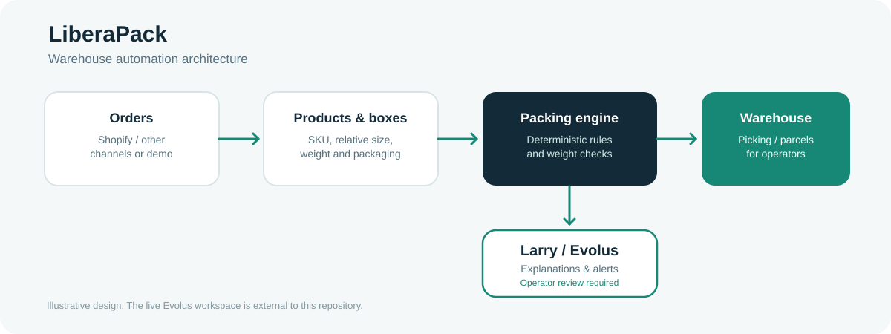

# LiberaPack

**Smart packing, order preparation and warehouse operations for e-commerce.**


LiberaPack is a software prototype developed for the October 2026 hackathon in Imperia. It helps a warehouse team organize product information, choose suitable packaging and prepare consolidated picking lists. Its AI assistant, **Larry**, is designed to work with Evolus to explain packing proposals and surface anomalies for human review.



## Live code in this repository

The repository contains **two independent interactive browser demos** and a **reproducible deterministic calculation API**.

| Component | Entry point | What it demonstrates |
| --- | --- | --- |
| Offline warehouse interface | [index.html](index.html) | Editable demo products, boxes, orders and sample workflow |
| Shopify-oriented interface | [shopify-demo.html](shopify-demo.html) | E-commerce warehouse dashboard and product/packing interactions |
| Packing and picking engine | [src/warehouse.mjs](src/warehouse.mjs) | Tested, deterministic sixths-based parcel assignment and aggregated picking |
| Local HTTP server | [server.mjs](server.mjs) | Sample JSON API and browser demo hosting |
| Larry / Evolus | [docs/EVOLUS.md](docs/EVOLUS.md) | Architecture and workflow export requirements; external workspace not yet imported |

## Three main sections

- **Orders:** view orders, quantities and preparation flow.
- **Products:** manage SKU information, categories, warehouse picking zones, relative sizes and weights.
- **Boxes:** define available packaging and evaluate suitable parcel assignments.

The reference core uses a **best-fit-decreasing heuristic**, relative capacity in sixths, and a strict **25 kg gross-weight cap per parcel**, including packaging weight. It reconciles ordered and packaged quantities. This **does not** establish 3D geometric packability or a mathematically optimal arrangement.

## Quick start

Install **Node.js 20+**, then:

```bash
git clone https://github.com/robertoonprogram/programmazioneapp.git
cd programmazioneapp
npm test
npm run demo
npm start
```

Open **http://127.0.0.1:4173** for the interactive offline interface and **http://127.0.0.1:4173/shopify-demo.html** for the second demo. Without Node, download the repository and open `index.html` directly in your browser.

The local server also exposes `GET /api/health`, `GET /api/sample`, `POST /api/pack` and `POST /api/picking`. See the [Quickstart](docs/QUICKSTART.md).

## Architecture and integrations

```text
Sales channel -> Orders
Product/box catalog -> Deterministic packing core
Packing core -> Parcels + aggregated picking
Validated summary -> Larry (Evolus) -> Explanation / human review
```

Shopify is an intended commerce connector, not a requirement for running the offline demo. The Evolus/AMD agent runtime is maintained outside this repository; no live external connection is claimed by the sample server.

## Optional Evolus agent chat

A server-side [Larry integration adapter](src/evolus-client.mjs) is included. It uses Evolus's documented OpenAI-compatible agent-chat endpoint and requires `EVOLUS_API_KEY`, `EVOLUS_APPLICATION_ID` and `EVOLUS_AGENT_ID`. It sends only a deliberately minimized parcel summary. To try it **after** configuring the authorized workspace, run `node examples/explain-with-larry.mjs`. Automated tests use a mock transport; a real call is not claimed.

## Docker demo

```bash
docker build -t liberapack .
docker run --rm -p 4173:4173 liberapack
```

Open `http://127.0.0.1:4173`. This is a **demo container without production authentication** and uses synthetic data only. See [Quickstart](docs/QUICKSTART.md).

## Documentation

- [System architecture](docs/ARCHITECTURE.md)
- [Start locally and use the API](docs/QUICKSTART.md)
- [Feature evidence and limitations](docs/FEATURE_STATUS.md)
- [Larry and Evolus](docs/EVOLUS.md)
- [Evolus workflow blueprint](evolus/WORKFLOW_BLUEPRINT.md)
- [Shopify connection guide](docs/SHOPIFY.md)
- [Hackathon submission checklist](docs/HACKATHON_SUBMISSION.md)
- [Short English demonstration script](docs/PRESENTATION_SCRIPT.md)
- [Roadmap](docs/ROADMAP.md)
- [Security and handling of secrets](SECURITY.md)

## Validation

Run `npm run check`, `npm test` and `npm run demo`. Automated CI runs the same checks on GitHub Actions. All fixture orders, products and boxes are synthetic.

**Important scope:** the complete Evolus workspace, original Shopify app source ZIP and previous historical OS1-related archives have not yet been imported here. This repository does not claim production Shopify synchronization, physical printer connectivity, confirmed AMD hosting or validated 3D geometry. Proprietary third-party code and customer information must not be committed without authorization.
