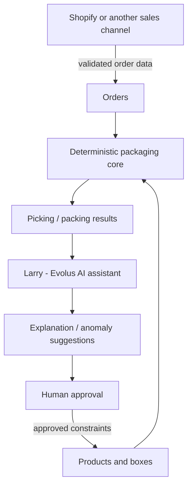

# LiberaPack architecture

## Purpose

LiberaPack connects an order-management interface, configurable products, and a packaging calculator to warehouse picking and an optional AI assistant.

### Main sections

1. **Ordini / Orders** — incoming orders, requested quantities, validation, preparation.
2. **Prodotti / Products** — SKU, category, picking location, relative size, weight, active/inactive state.
3. **Scatole / Boxes** — packaging formats, usable capacity, packaging tare and selection.

Warehouse outputs include consolidated picking lists and per-order package breakdowns.

## Boundaries

The **deterministic core** must be the authority for counts, capacity, and packaging constraints. Larry can interpret, explain, and coordinate actions. It should not silently alter physical quantities or approved constraints.

## Implementations in this repository

- `index.html` is an offline demo with its own in-browser logic.
- `shopify-demo.html` is a separate Shopify-oriented interface demo; it does not imply Shopify has been installed or authenticated.
- `src/` contains an independent, testable example of the sixths-based capacity and picking logic.
- The real Evolus agent and its workflows are **not exported into this repository**; see `docs/EVOLUS.md`.

## Algorithm levels

**MVP currently reproducible from the repository:** item counts, configurable relative capacities (sixths), weight limits, aggregated picking and deterministic assignment.

**More advanced target:** full geometry with orientations, stacking, dividers, fragile products, compartment dimensions and approved warehouse feedback. A simple sixths-based calculator does **not** prove three-dimensional packability.

## Integration roadmap

Storefront integrations (Shopify and other systems) should normalize incoming orders to a stable internal contract, then call the deterministic core. External AI execution and credentials are handled on a server or inside Evolus; physical label printing may need a local print bridge.
