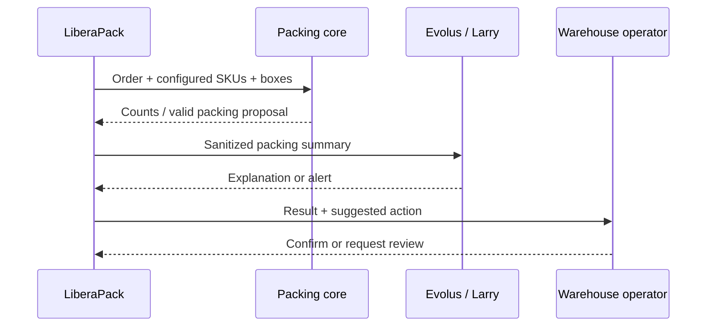

# Larry and Evolus integration

LiberaPack uses **Larry** as the name of its warehouse-oriented AI agent. Larry is designed to explain packing decisions, support operators, flag anomalies and help organize warehouse workflows.

The Evolus project is maintained separately. **This repository does not contain a verified export of the live Larry agent, knowledge collection or workflow definitions.** Its presence here as a design component does not claim a live connection.

## Planned responsibilities

- Summarize batches of orders, total quantities and packaging outcomes.
- Explain in plain language why a package was selected or rejected.
- Flag missing dimensions, inconsistent SKU data, overweight parcels and other anomalies.
- Direct the warehouse operator to review suggested rule changes.
- Work with business workflow automation, while keeping the numeric packing decision deterministic.

## Reference flow

## Evolus/AMD reproducibility checklist

To document a real implementation, export or provide these **non-secret** items from the authorized workspace:

1. Larry's agent configuration and non-sensitive system instructions, with platform export if supported.
2. Workflow definitions, triggers, enabled components and input/output mappings.
3. Knowledge Library structure and sample public documents (never confidential business files).
4. The model identifier and evidence that the required open model runs on the appropriate AMD infrastructure.
5. A screenshot or log of a successful execution with IDs and tokens removed.
6. An API integration sample with placeholder credentials and a successful anonymized test.

The preliminary connection design names `EVOLUS_APPLICATION_ID`, `EVOLUS_AGENT_ID`, `EVOLUS_BASE_URL` and `EVOLUS_API_KEY`. Their values belong in environment configuration, never in GitHub. Verify the live API schema from the actual Evolus workspace before developing the adapter.

## Reference chat adapter

The repository includes [src/evolus-client.mjs](../src/evolus-client.mjs). It calls the documented OpenAI-compatible agent-chat endpoint `https://api.evolus.ai/v1/chat/completions`, using `<applicationId>:<agentId>` as the model and a server-side Bearer API key. The adapter removes direct customer details from the payload.

To call it, configure the environment variables in `.env.example` privately and run `node examples/explain-with-larry.mjs`. Do not confuse its mocked automated tests with a successful live call. The workflow REST API requires separate integration and workspace authorization.

Official event API overview: https://lablab.ai/ai-hackathons/amd-developer-hackathon-act-iii

## Verification status

| Feature | Repository evidence |
| --- | --- |
| Offline warehouse demo | Present |
| Deterministic packing example | Present in `src/` |
| Larry agent chat adapter | Included (mock-tested); live keys and workspace required |
| Larry agent configuration | Export required |
| Evolus workflow definition | Export required |
| AMD runtime evidence | Export/screenshot required |
| Live Evolus API call | Not verified from this repository |

Do not copy an access key into a screenshot, commit or issue.
